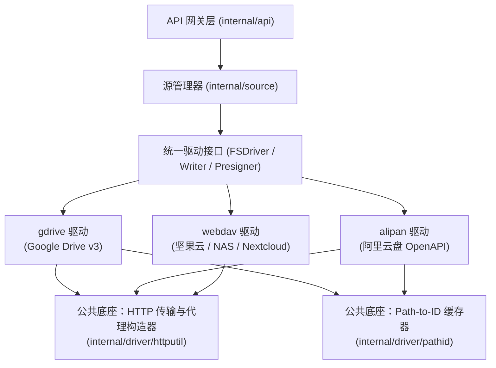

# u-file · 云盘与标准存储协议驱动详细设计（WebDAV / Google Drive / 阿里云盘）

> 状态：v1.0（2026-11-04 已实现落地）  
> 关联文档：[02-需求与产品规划](./02-需求与产品规划.md) · [03-技术可行性分析](./03-技术可行性分析.md) · [04-总体架构设计](./04-总体架构设计.md)

## 1. 背景与目标

在已完成 `local`、`s3`、`ftp`、`sftp` 四类驱动（M0~M2）的基础上，扩展支持三大高频个人/团队云盘与协议源：

1. **`webdav`（坚果云 / Nextcloud / 群晖 NAS / OpenList 桥接）**：基于标准 WebDAV（RFC 4918）协议，路径直接寻址，零外部 SDK 依赖，可一次性打通坚果云及所有兼容 WebDAV 的存储服务。
2. **`gdrive`（Google Drive）**：基于 Google Drive API v3，支持个人云盘（OAuth2 Refresh Token）与企业/团队盘（Service Account JSON），内置 HTTP/SOCKS5 代理配置以适应国内网络环境。
3. **`alipan`（阿里云盘 OpenAPI）**：基于阿里云盘官方开放平台（`openapi.alipan.com`），支持资源库/备份盘切换、预签名直链下载（`Presigner`）与分片流式上传。

### 1.1 非目标（边界声明）
- **不引入逆向 Cookie 驱动**：本设计全部基于标准协议（WebDAV）或官方公开 OpenAPI（Google Drive v3、阿里云盘 OpenAPI），保障长期稳定性。
- **不改变上层 [`FSDriver`](../internal/driver/driver.go) 核心契约**：所有协议差异（如云盘的 `file_id` 寻址、OAuth2 令牌刷新、分片上传协议）严格封装在 `internal/driver/` 内部。

---

## 2. 总体架构与公共底座设计

### 2.1 架构分层图



### 2.2 公共组件一：`Path-to-ID` 树形路径解析与缓存器（`internal/driver/pathid`）

Google Drive 与阿里云盘均为 **`file_id`（节点 ID）寻址**，而非 POSIX 路径寻址。为了向 [`FSDriver`](../internal/driver/driver.go) 暴露统一的相对路径（如 `docs/report/2026.pdf`），抽象一个通用的并发安全路径缓存器 `Resolver`：

- **数据结构**：
  - 缓存键：规范化相对路径 `cleanPath`（`""` 代表源配置的 `root_folder_id`）。
  - 缓存值：`Node{ID string, IsDir bool, Size int64, ModTime time.Time, ETag string, ExpireAt time.Time}`。
- **解析流程（`Resolve(ctx, path)`）**：
  1. 若 `path == ""`，直接返回 `{ID: rootFolderID, IsDir: true}`；
  2. 命中未过期的缓存条目则直接返回（O(1)）；
  3. 若未命中，采取**最长前缀匹配**：从最长已缓存的祖先目录 ID 开始，逐级向下调用具体驱动注入的 `LookupChild(ctx, parentID, childName)` 或通过 `ListChildren(ctx, parentID)` 批量预热同级目录所有子项缓存。
- **缓存一致性与失效策略**：
  - 默认 TTL：`5 分钟`（与上层索引缓存配合）；
  - **写穿/主動失效**：当驱动执行 `Upload`、`Delete`、`Mkdir`、`Rename` 时，主动更新或清除 `InvalidatePrefix(path)` 对应节点及其子树缓存，确保写操作后立即浏览可见。
- **同名文件消歧规则**：
  - Google Drive 允许同一目录下存在同名文件：当按名称匹配到多条记录时，优先取未放入回收站（`trashed = false`）且 `modifiedTime` 最新的一条；在 `List` 时若发现同名项，日志告警并稳定按修改时间排序展示。

### 2.3 公共组件二：HTTP 客户端与代理构造器（`internal/driver/httputil`）

针对云盘 API 常见的网络代理与超时需求，提供统一构造器：
- 支持配置 `proxy_url`（支持 `http://`、`https://`、`socks5://`）；
- 连接池与超时基线：`DialTimeout = 10s`、`TLSHandshakeTimeout = 10s`、`ResponseHeaderTimeout = 30s`，**不设全局 `Client.Timeout`**（避免大文件流式下载/上传在中途被掐断）。

### 2.4 凭据加密与脱敏扩展（`internal/source/manager.go`）

现有 [`isSecretKey`](../internal/source/manager.go#L65-L71) 仅识别 `access_key`、`secret_key`、`password`。需扩展敏感字段白名单，确保新驱动的所有密钥落盘即 AES-256-GCM 加密、API 响应自动打码为 `******`：

```go
func isSecretKey(k string) bool {
	switch k {
	case "access_key", "secret_key", "password",
		"private_key", "private_key_passphrase", // SFTP 补齐
		"refresh_token", "client_secret", "service_account_json": // 云盘 OAuth2 / 服务账号
		return true
	}
	return false
}
```

### 2.5 Refresh Token 滚动刷新与持久化回调（可选增强）

阿里云盘（以及部分 OAuth2 服务）在用 `refresh_token` 换取新 `access_token` 时，会返回一个**新的 `refresh_token`**，旧的随即失效。
- 在驱动内部维护内存态最新 `access_token` 与 `refresh_token`（带 `sync.Mutex` 单飞刷新，避免并发请求同时触发刷新导致令牌竞争失效）；
- 支持在 `cfg` 中注入可选内部回调或由 `source.Manager` 监听驱动配置变更，将滚动更新后的 `refresh_token` 原子加密回写至 `data/sources.json`，防止服务重启后旧 `refresh_token` 过期。

---

## 3. 各驱动详细设计

### 3.1 `webdav` 驱动（坚果云 / Nextcloud / NAS）

- **包路径**：`internal/driver/webdav`（`scheme = "webdav"`）
- **能力声明（`Capabilities`）**：
  - `List: true`, `Stat: true`, `Download: true`, `Write: true`
  - `PresignURL: false`, `ListCursor: false`
- **依赖选型**：直接基于 Go 标准库 `net/http` + `encoding/xml` 自研轻量客户端（约 300 行代码，零第三方库依赖），完整掌控流式读写与 XML 命名空间解析兼容性。

#### 配置项定义（`config`）

| 字段名 | 类型 | 必填 | 默认值 | 说明 |
|---|---|---|---|---|
| `endpoint` | string | 是 | — | WebDAV 服务根地址，如坚果云 `https://dav.jianguoyun.com/dav/` |
| `username` | string | 否 | `""` | 账号（坚果云为注册邮箱） |
| `password` | string(加密) | 否 | `""` | 密码或**应用专用密码** |
| `root` | string | 否 | `""` | 挂载子目录前缀（如 `/我的坚果云/备份`） |
| `insecure_tls` | bool | 否 | `false` | 跳过自签名证书校验（群晖/自建 NAS 常用） |
| `proxy_url` | string | 否 | `""` | 可选代理地址 |

#### 协议映射实现细节
1. **`List(ctx, dir)`**：
   - 发送 `PROPFIND` 请求，Header 带 `Depth: 1`，Body 请求 `d:resourcetype`、`d:getcontentlength`、`d:getlastmodified`、`d:getetag`。
   - 解析 `207 Multi-Status` XML 响应，过滤掉当前目录自身项（首条 href 与请求路径一致的项），将 `d:collection` 映射为 `IsDir: true`。
2. **`Stat(ctx, path)`**：
   - 发送 `PROPFIND`（`Depth: 0`），不存在时映射 HTTP 404 → `driver.ErrNotFound`。
3. **`Open(ctx, path, opt)`**：
   - 发送 `GET` 请求；若 `opt.Offset > 0 || opt.Length > 0`，附加标准 `Range: bytes=offset-end` 请求头，直接返回 `resp.Body`（真流式，支持视频拖拽与断点续传）。
4. **写操作（`Writer`）**：
   - `Upload`：先确保父目录存在（递归 `MKCOL`），再发送 `PUT` 请求，Body 直接挂载 `io.Reader`，若 `size >= 0` 设置 `Content-Length`。
   - `Mkdir`：按层级发送 `MKCOL`（405 Method Not Allowed 视为目录已存在）。
   - `Delete`：发送 `DELETE` 请求（WebDAV 标准语义天然支持递归删除集合）。
   - `Rename`：发送 `MOVE` 请求，Header 带 `Destination: <目标完整 URL>` 与 `Overwrite: T`。
5. **坚果云特殊适配注意点**：
   - 坚果云免费版有请求频率限制（约 600 次 / 30 分钟），驱动遇到 `429 Too Many Requests` 或 `503` 时返回可读中文错误提示；
   - 坚果云根目录不允许直接上传文件或新建第一层文件夹（必须在 `/我的坚果云/` 或已有同步文件夹下操作），在前端表单提示中明确给出 `https://dav.jianguoyun.com/dav/我的坚果云` 示例。

---

### 3.2 `gdrive` 驱动（Google Drive）

- **包路径**：`internal/driver/gdrive`（`scheme = "gdrive"`）
- **能力声明（`Capabilities`）**：
  - `List: true`, `Stat: true`, `Download: true`, `ListCursor: true`, `Write: true`
  - `PresignURL: false`（Google Drive 下载需携带 `Authorization: Bearer` 头，无法生成免 Header 的纯 URL 直链，统一走网关流式代理）
- **依赖选型**：基于标准 REST JSON API（`https://www.googleapis.com/drive/v3`）+ 标准 `crypto/rsa`（Service Account JWT 签名）或 `golang.org/x/oauth2`，保持编译产物体积轻量。

#### 配置项定义（`config`）

| 字段名 | 类型 | 必填 | 默认值 | 说明 |
|---|---|---|---|---|
| `auth_type` | string | 否 | `"oauth2"` | `"oauth2"`（个人/团队盘）或 `"service_account"`（服务账号） |
| `client_id` | string | 条件 | — | `auth_type=oauth2` 时必填 |
| `client_secret` | string(加密) | 条件 | — | `auth_type=oauth2` 时必填 |
| `refresh_token` | string(加密) | 条件 | — | `auth_type=oauth2` 时必填 |
| `service_account_json` | string(加密) | 条件 | — | `auth_type=service_account` 时必填（完整 JSON 密钥内容） |
| `root_folder_id` | string | 否 | `"root"` | 起始目录 File ID（默认 `"root"`，可填任意共享文件夹 ID） |
| `drive_id` | string | 否 | `""` | 共享云端硬盘（Shared Drive / 团队盘）ID，留空为个人盘 |
| `proxy_url` | string | 否 | `""` | HTTP/SOCKS5 代理，如 `http://127.0.0.1:7890` |

#### 协议映射实现细节
1. **`List(ctx, dir, opt)`**：
   - 通过 `pathid.Resolver` 将 `dir` 解析为 `folderID`。
   - 调用 `GET /drive/v3/files`：
     - `q`: `'<folderID>' in parents and trashed = false`
     - `fields`: `nextPageToken, files(id, name, mimeType, size, modifiedTime, md5Checksum)`
     - `pageSize`: `opt.Limit`（默认 200，上限 1000），`pageToken`: `opt.Cursor`
     - 若配置了团队盘，附带 `supportsAllDrives=true&includeItemsFromAllDrives=true`。
   - 将 `mimeType == "application/vnd.google-apps.folder"` 映射为 `IsDir: true`；其余 Google 在线文档（`vnd.google-apps.document` 等无二进制 `size` 的类型）在列表标记 `Size: 0`。
2. **`Open(ctx, path, opt)`**：
   - 解析出 `fileID`；
   - 调用 `GET /drive/v3/files/{fileID}?alt=media&supportsAllDrives=true`；
   - 若 `opt.Offset > 0 || opt.Length > 0`，设置 `Range: bytes=offset-end` 请求头，实现流式读取与视频拖拽。
3. **写操作（`Writer`）**：
   - `Upload`：使用 Google Drive `resumable` 或 `multipart` 上传协议（`POST /upload/drive/v3/files?uploadType=resumable`）。先发元数据 JSON（`name` + `parents: [parentID]`）拿到 `Location` 上传会话 URL，再将 `io.Reader` 流式 `PUT` 上去；若目标同名文件已存在，走 `PATCH /upload/drive/v3/files/{existingID}` 覆盖内容。
   - `Mkdir`：逐级检查并创建 `mimeType = "application/vnd.google-apps.folder"`。
   - `Delete`：默认移动到回收站（`PATCH /drive/v3/files/{fileID}` 设置 `{"trashed": true}`）或永久删除（可通过配置项 `use_trash: true` 控制，默认进回收站防止误删，且对于非 Owner 的共享文件仅允许 `trashed: true`）。
   - `Rename`：`PATCH /drive/v3/files/{fileID}`，同目录仅改 `name`；跨目录同时带 `addParents=<newParentID>&removeParents=<oldParentID>`。

---

### 3.3 `alipan` 驱动（阿里云盘 OpenAPI）

- **包路径**：`internal/driver/alipan`（`scheme = "alipan"`）
- **能力声明（`Capabilities`）**：
  - `List: true`, `Stat: true`, `Download: true`, `PresignURL: true`, `ListCursor: true`, `Write: true`
- **接口基址**：`https://openapi.alipan.com`

#### 配置项定义（`config`）

| 字段名 | 类型 | 必填 | 默认值 | 说明 |
|---|---|---|---|---|
| `refresh_token` | string(加密) | 是 | — | OAuth2 刷新令牌 |
| `client_id` | string | 否 | `""` | 开放平台应用 AppID（自建应用时填） |
| `client_secret` | string(加密) | 否 | `""` | 开放平台应用 AppSecret（配合 `client_id` 使用） |
| `oauth_token_url` | string | 否 | 官方默认 | 可选三方换 Token 代理地址（未申请到企业 `client_secret` 的个人用户常用） |
| `drive_type` | string | 否 | `"backup"` | `"backup"`（备份盘 `backup_drive_id`）或 `"resource"`（资源库 `resource_drive_id`） |
| `root_folder_id` | string | 否 | `"root"` | 挂载起始目录 `file_id`，默认 `"root"` |

#### 协议映射实现细节
1. **初始化与 `drive_id` 获取**：
   - 首次请求时通过 `/oauth/access_token`（或 `oauth_token_url`）换取 `access_token`，再调 `POST /adrive/v1.0/user/getDriveInfo` 获取账号对应的 `backup_drive_id` / `resource_drive_id` 并缓存在驱动实例中。
2. **`List(ctx, dir, opt)`**：
   - 解析 `dir` 对应的 `parent_file_id`；
   - 调用 `POST /adrive/v1.0/openFile/list`（传 `drive_id`、`parent_file_id`、`limit`、`marker: opt.Cursor`），返回 `items` 与 `next_marker`。
3. **`PresignGet(ctx, path, ttl)` 与 `Open(ctx, path, opt)`**：
   - 调用 `POST /adrive/v1.0/openFile/getDownloadUrl`（有效期最高支持 `14400` 秒即 4 小时）；
   - **`Presigner` 直链能力**：直接返回接口给出的 `url`（阿里云盘 OpenAPI 的下载 URL 支持免 Header 直接下载，且支持 Range，开启直链后浏览器直接从阿里云 CDN 拉流，不占 `u-file` 带宽）；
   - **网关流式 `Open`**：拿到下载 `url` 后由服务端发起带 `Range` 头的 HTTP `GET` 并返回 `resp.Body`。
4. **写操作（`Writer`）**：
   - `Upload`：遵循阿里云盘三步协议：
     1. `POST /adrive/v1.0/openFile/create`（`check_name_mode: "overwrite"`，按 10MB 分片计算 `part_info_list`）获取 `upload_id` 与各分片 `upload_url`；
     2. 循环从 `io.Reader` 读取分片流式 `PUT` 到对应 `upload_url`（内存只保留单个分片缓冲区 ≤ 10MB）；
     3. `POST /adrive/v1.0/openFile/complete` 完成合并。
   - `Mkdir`：`POST /adrive/v1.0/openFile/create`（`type: "folder"`, `check_name_mode: "refuse"`）。
   - `Delete`：`POST /adrive/v1.0/openFile/recyclebin/trash`（移入回收站）。
   - `Rename`：同目录改名调 `POST /adrive/v1.0/openFile/update`；跨目录移动调 `POST /adrive/v1.0/openFile/move`（若同时改名则移动后追加一次 `update`）。

---

## 4. 前端源管理弹窗（`SourceDialog.vue`）改造计划

当前 [`SourceDialog.vue`](../web/src/components/SourceDialog.vue#L142-L147) 的类型下拉框仅渲染了 `s3` 与 `local`（M2 已在后端实现的 `ftp`、`sftp` 也尚未在重构后的 Vue 弹窗中补齐表单项）。本次一并补齐全部 **7 种源类型**的动态表单：

| 类型值 | 前端下拉展示名称 | 动态表单核心字段 |
|---|---|---|
| `s3` | `s3 —— 对象存储（S3/MinIO/R2/OSS/COS/OBS/Kodo/BOS）` | Endpoint, Region, Bucket, Prefix, AK/SK, Path-Style |
| `local` | `local —— 本地磁盘` | Root 目录 |
| `ftp` | `ftp —— FTP / FTPS 服务器` | Host, Port(21), Username, Password, Root, TLS / InsecureTLS |
| `sftp` | `sftp —— SFTP (SSH) 服务器` | Host, Port(22), Username, Password / PrivateKey, Passphrase, Root |
| `webdav` | `webdav —— WebDAV（坚果云 / Nextcloud / NAS）` | Endpoint（含坚果云一键填入预设按钮）, Username, Password, Root, InsecureTLS |
| `gdrive` | `gdrive —— Google Drive（个人盘 / 团队盘）` | 认证方式切换（OAuth2 / Service Account JSON）、Root Folder ID、Drive ID、Proxy URL |
| `alipan` | `alipan —— 阿里云盘（OpenAPI）` | 盘类型切换（备份盘/资源库）、Refresh Token、Client ID/Secret（或 Token 代理 URL）、Root Folder ID |

---

## 5. 测试与验收计划

每个新驱动均配备**离线单元测试（Mock Server）** + **真实环境可选冒烟测试（环境变量触发）**：

1. **`internal/driver/pathid/resolver_test.go`**：
   - 验证多级路径解析、缓存命中率、TTL 过期、写操作后子树缓存精准失效、并发安全（`go test -race`）。
2. **`internal/driver/webdav/webdav_test.go`**：
   - 使用 `httptest.NewServer` 搭建内置 WebDAV 模拟服务端（或基于 `golang.org/x/net/webdav` 内存文件系统），完整跑通 `List` → `Upload` → `Stat` → `Open(Range)` → `Mkdir` → `Rename` → `Delete` 全生命周期单测。
3. **`internal/driver/gdrive/gdrive_test.go`**：
   - Mock Google Drive v3 REST 端点，测试 OAuth2 / Service Account 令牌获取、`q` 语法转义（文件名含单引号 `'` 或反斜杠）、分页游标、Range 下载与 Resumable 上传。
4. **`internal/driver/alipan/alipan_test.go`**：
   - Mock 阿里云盘 OpenAPI 端点，测试 `refresh_token` 滚动刷新回写、302 直链签名生成、分片流式上传（`create` -> `PUT part` -> `complete`）。
5. **凭据加密与导入导出回归测试（`internal/source/crypto_persist_test.go`）**：
   - 验证 `refresh_token`、`client_secret`、`service_account_json`、`private_key` 在 `data/sources.json` 中均以 `enc:v1:` 密文形态落盘，且 API `/api/v1/sources` 返回 `******`。

---

## 6. 分步实施排期（建议顺序）

| 阶段 | 任务 | 交付物 |
|---|---|---|
| **Step 1：公共底座与凭据安全** | 实现 `internal/driver/pathid`（路径-ID 缓存器）、`internal/driver/httputil`（代理与传输层）、扩展 `source` 敏感字段加密列表与 `refresh_token` 回写 | 底座代码 + 单元测试 |
| **Step 2：`webdav` 驱动（含坚果云适配）** | 实现 `internal/driver/webdav`（`FSDriver` + `Writer`），注册到 `driver/all` | `webdav` 驱动 + 全流程单测 |
| **Step 3：`gdrive` 驱动** | 实现 `internal/driver/gdrive`（OAuth2 + Service Account + 代理支持 + 读写全套） | `gdrive` 驱动 + Mock 单测 |
| **Step 4：`alipan` 驱动** | 实现 `internal/driver/alipan`（OpenAPI + `Presigner` 直链 + 分片上传） | `alipan` 驱动 + Mock 单测 |
| **Step 5：前端 UI 与文档同步** | 更新 [`SourceDialog.vue`](../web/src/components/SourceDialog.vue) 支持全部 7 种源类型（含 `ftp`/`sftp`/`webdav`/`gdrive`/`alipan`），重新构建 `web/dist` 并更新 `README.md` 与 `config.example.yaml` | 前后端联调通过 |
