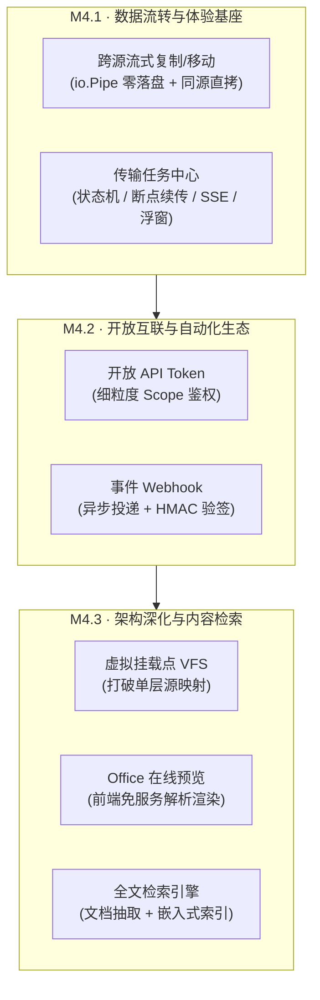
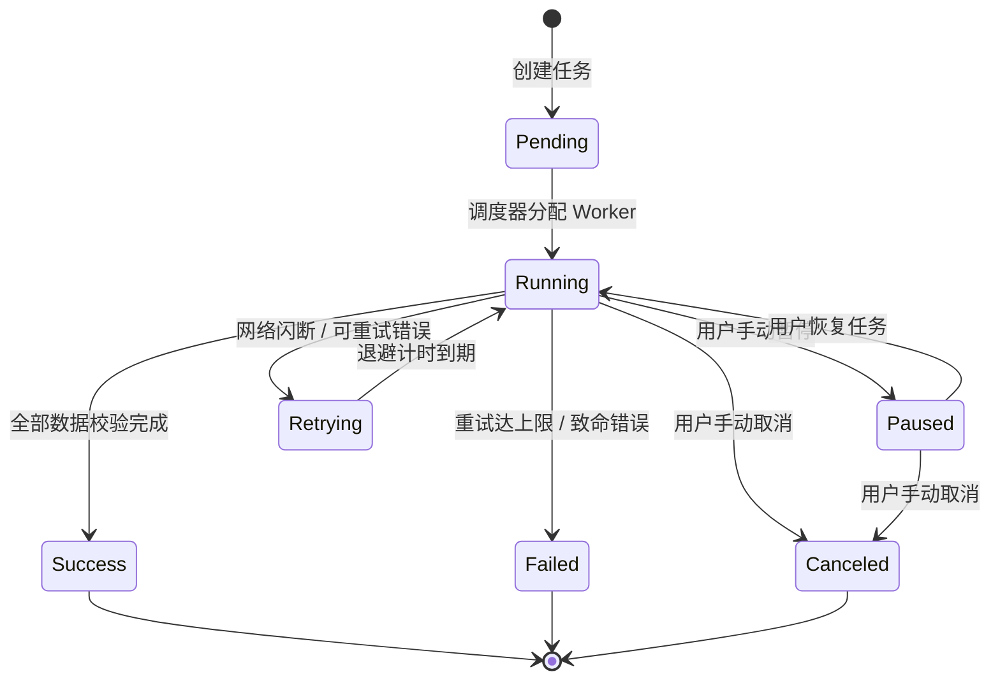

# u-file · M4 中远期需求与架构设计

> 版本：v1.1（2026-11-05 经需求调整：暂缓 WebDAV 服务端与数据库文件源）  
> 关联文档：[01-调研报告](./01-调研报告.md) · [02-需求与产品规划](./02-需求与产品规划.md) · [03-技术可行性分析](./03-技术可行性分析.md) · [04-总体架构设计](./04-总体架构设计.md) · [05-云盘与WebDAV驱动设计](./05-云盘与WebDAV驱动设计.md)

---

## 1. 背景与目标

在完成了 **M0（核心驱动抽象与流式网关）**、**M1（源凭据加密/索引缓存/登录审计）**、**M2（FTP/SFTP/写操作/打包/搜索/Vue 3 工程化）** 以及 **M3（外链分享/WebDAV·GDrive·阿里云盘客户端驱动/密码信封加密/多主题）** 之后，`u-file` 已经具备了完整的个人与中小团队异构存储统一聚合管理能力。

**M4 / P3 阶段**的目标是推动 `u-file` **从“单纯聚合浏览与单步操作门户”演进为“高性能数据流转中枢与开放互联平台”**。核心聚焦解决以下深层痛点：

1. **大文件与批量操作前台阻塞**：当前上传、跨目录处理必须停留在当前页面，缺乏后台异步任务队列与断点重试机制；
2. **异构存储间数据孤立**：缺乏源与源之间的直接流式复制与搬迁能力；
3. **自动化集成受限**：缺乏开放 API Token 与事件 Webhook，无法与外部脚本或 CI/CD 系统联动；
4. **层级僵化与检索维度浅**：“源即挂载点”无法支持灵活的虚拟目录树；仅支持文件名匹配，无法检索文档正文。

### 1.1 范围调整与裁剪决策（De-scope）
经产品优先级评审，本次规划明确**暂缓以下两项**，集中资源突破高频核心链路：
- ⏸️ **WebDAV 服务端（对外暴露聚合挂载）**：第三方操作系统客户端（尤其是 Windows WebClient）协议兼容性碎片化严重、锁机制开销大，且平台已有精致响应式 Web 端、公开分享页及规划中的开放 API，外部挂载非当前刚需，先不投入。
- ⏸️ **数据库文件源（BLOB / Large Object / GridFS）**：SQL 驱动天然缺乏原生流式支持易引起内存隐患，企业实际落地 BLOB 文件表场景低频，投入产出比低，暂缓纳入。

---

## 2. 分阶段演进规划总览

裁剪后，M4 聚焦于核心传输体验、开放生态与目录检索深化，分为三个小版本渐进式落地：

| 阶段 | 核心主题 | 包含功能点 | 预估周期 | 交付价值 |
|---|---|---|---|---|
| **M4.1** | **高频实用：任务中心与跨源流转** | 1. 传输任务中心（调度引擎、断点续传、前端浮窗）<br>2. 跨源流式复制/移动（管道直推、同源短路、事务补偿） | 3~4 人周 | 解放前台操作，打通存储间数据流转 |
| **M4.2** | **开放互联：自动化与事件生态** | 1. 开放 API Token（细粒度 Scope 鉴权）<br>2. 事件 Webhook（标准事件模型与签名验签） | 2~3 人周 | 打通脚本与 CI/CD 自动化集成链路 |
| **M4.3** | **企业深化：VFS 挂载、检索与 Office 预览** | 1. 虚拟多挂载点树（VFS 抽象）<br>2. Office 在线预览（前端轻量免服务渲染）<br>3. 全文检索引擎（文档抽取 + 嵌入式倒排索引） | 3~4 人周 | 复杂组织架构目录映射、文档深度检索与全格式预览 |



---

## 3. 阶段一（M4.1）：传输任务中心与跨源流转

### 3.1 传输任务中心（Task Center）

#### 3.1.1 业务诉求
- 批量上传、超大文件上传、跨源复制等长耗时操作在后台异步执行，用户可切换页面甚至短暂离线；
- 失败任务自动/手动重试；
- 统一管理全局并发度，防止占满带宽或触发云厂商 API 频次风控。

#### 3.1.2 任务状态机设计


#### 3.1.3 核心数据模型
持久化记录在 `data/tasks.json`：
```json
{
  "id": "task_9f8a2b1c",
  "type": "upload | copy | move | sync",
  "user_id": "u_admin",
  "source_id": "oss-prod",
  "target_source_id": "backup-sftp",
  "src_path": "photos/2026.zip",
  "dst_path": "archive/2026.zip",
  "total_bytes": 10737418240,
  "transferred_bytes": 4294967296,
  "speed_bps": 15728640,
  "status": "running",
  "retry_count": 1,
  "max_retries": 5,
  "error_msg": "",
  "created_at": 1793865600,
  "updated_at": 1793865630
}
```

#### 3.1.4 调度与限流架构
- **Worker Pool**：配置全局并发任务数（默认 `4`），单源并发上限（默认 `2`）；
- **进度跟踪**：通过包装 `io.Reader`（`ProgressReader`）原子累加字节计数；
- **前端实时感知**：提供 `GET /api/v1/tasks/events`（Server-Sent Events, SSE），支持高频低开销推送进度；不支持 SSE 环境自动降级为 2s 轮询；
- **前端交互**：Element Plus 悬浮面板（位于页面右下角），展示活跃任务数、实时速率、进度条与暂停/重试控制。

---

### 3.2 跨源复制与移动（Cross-Source Transfer）

#### 3.2.1 管道中转架构（零落盘）
不同存储系统间复制数据时，严格贯彻面向流原则，利用 Go 的 `io.Pipe()` 将源端读取与目标端写入直接对接，严禁落地到磁盘临时文件：

```
┌─────────────────┐             ┌─────────────────┐             ┌─────────────────┐
│ 源端驱动 (Src)   │             │   传输网关核心   │             │ 目标端驱动 (Dst) │
│ (如: S3 / WebDAV│             │  (Task Worker)  │             │ (如: SFTP / 本地)│
└────────┬────────┘             └────────┬────────┘             └────────┬────────┘
         │                               │                               │
         │ 1. Download(ctx, path)        │                               │
         ├──────────────────────────────>│                               │
         │   返回 io.ReadCloser          │ 2. io.Pipe() 管道对接          │
         │                               │   ProgressReader 包装统计      │
         │                               │                               │
         │                               │ 3. Upload(ctx, dstPath, pipe) │
         │                               ├──────────────────────────────>│
         │                               │                               │
         │ 4. 数据边拉边推 (Backpressure 由管道阻塞保证，内存恒定 32KB)    │
         │==============================================================>│
         │                               │                               │
         │                               │ 5. 上传完成，校验 Size/ETag   │
         │                               │<──────────────────────────────┤
         │ 6. (若为移动) 确认无误后执行删除 │                               │
         │<──────────────────────────────┤                               │
```

#### 3.2.2 协议级直拷短路优化（Fast Path）
在调用通用管道复制前，检查是否满足**协议内部直拷**条件：
1. **同 S3 兼容源 / 同 Bucket**：直接调用 S3 `CopyObject` API，数据由云厂商内部转存，服务器零网络流量消耗，秒级完成；
2. **同网盘源（Google Drive / 阿里云盘）**：调用其原生 Move/Copy API；
3. **本地源与 SFTP 源（同宿主）**：触发底层操作系统重命名或硬链接。

#### 3.2.3 移动语义与失败保护（事务补偿）
跨异构源“移动”本质为 `Copy + Delete`。必须采取严格的防御性控制：
- 目标端写入完成后，必须调用 `DstDriver.Stat()` 校验大小（与源一致）；
- 只有目标端完整性校验 100% 成功，才允许触发 `SrcDriver.Delete()`；
- 若目标端写入中断或校验失败，立即清理目标端半成品残留，源端文件保持不动，并标记任务为 `failed`。

---

## 4. 阶段二（M4.2）：开放互联与自动化生态

### 4.1 开放 API Token 系统

#### 4.1.1 需求与定位
面向开发者和自动化运维脚本（curl、CI/CD 构建物归档、定时数据拉取），无需模拟 Web 登录换取短期 JWT，提供长效、受限的访问令牌。

#### 4.1.2 权限作用域（Scope Matrix）
| Scope 名称 | 允许操作 | 典型场景 |
|---|---|---|
| `files:read` | 列表、元数据、下载、在线预览 | 脚本自动化下载、数据采集 |
| `files:write` | 上传、新建目录、重命名 | 构建脚本产物上传、日志转储 |
| `files:delete` | 删除文件与目录 | 自动化归档清理脚本 |
| `sources:read` | 查看文件源列表与状态 | 监控巡检 |
| `shares:manage` | 创建、查询与撤销外链分享 | 第三方系统动态生成临时外链 |

#### 4.1.3 安全防范
- **存储加密**：Token 明文只在创建时返回一次（格式 `uft_` + 32 字节安全随机串），服务端仅持久化其 SHA-256 哈希值；
- **细粒度约束**：每个 Token 可绑定：允许的 Source 范围（如仅限 `backup-sftp`）、IP 白名单、到期时间；
- **即时吊销**：管理员可随时在后台一键撤销任意 Token。

---

### 4.2 事件驱动与 Webhook

#### 4.2.1 事件定义
当平台内发生重要生命周期变动时，产生标准 JSON 事件报文：
```json
{
  "event_id": "evt_1a2b3c4d5e",
  "event_type": "file.uploaded",
  "timestamp": 1793865600,
  "source_id": "oss-prod",
  "data": {
    "path": "reports/q3.xlsx",
    "size": 154820,
    "etag": "\"9b10ba34...\"",
    "operator": "u_admin",
    "ip": "192.168.1.10"
  }
}
```

支持事件类型包括：
- `file.uploaded` / `file.deleted` / `file.renamed`
- `share.created` / `share.expired` / `share.accessed`
- `sync.completed` / `sync.failed`

#### 4.2.2 投递机制与安全校验
- **异步重试队列**：Webhook 投递失败后，采用指数退避重试（10s、30s、2m、10m），最多重试 5 次；
- **HMAC 签名验签**：向目标 URL 发送请求时附带 `X-UFile-Signature: sha256=<hex>` 请求头，使用用户配置的 Webhook Secret 签名，接收方可防篡改校验。

---

## 5. 阶段三（M4.3）：虚拟多挂载点、Office 预览与全文检索

### 5.1 虚拟多挂载点树（VFS 架构升级）

#### 5.1.1 现状与瓶颈
当前版本采用“源即挂载点”的简化模型（每个源固定映射为顶层目录 `/{source_id}/...`）。  
在多部门或复杂业务场景下，存在以下不足：
- 无法将多个源的子目录组织在同一业务目录下（如把 S3 的 `contracts/` 和 SFTP 的 `invoices/` 归并到 `/财务资料/` 统一入口）；
- 无法隐藏底层物理存储源的名称与协议细节。

#### 5.1.2 挂载表设计与路径路由算法
建立虚拟挂载表 `data/mounts.json`：
```json
[
  {
    "id": "mnt_1",
    "mount_path": "/财务文档/合同",
    "source_id": "oss-finance",
    "source_path": "/2026/contracts",
    "readonly": true
  },
  {
    "id": "mnt_2",
    "mount_path": "/财务文档/发票",
    "source_id": "sftp-tax",
    "source_path": "/invoices",
    "readonly": false
  }
]
```

**路由寻址（前缀最长匹配算法）**：
1. 请求访问路径 `/财务文档/合同/公司A.pdf`；
2. 匹配到挂载点 `mnt_1`（挂载路径 `/财务文档/合同` 最长匹配）；
3. 相对路径转换计算：`subPath = "公司A.pdf"`；
4. 目标物理路径：`source_path + "/" + subPath` = `/2026/contracts/公司A.pdf`；
5. 调用 `oss-finance` 驱动执行对应操作；若挂载点标记为 `readonly: true`，直接拦截写操作。

---

### 5.2 Office 文档在线预览增强

* **实现策略**：**前端纯静态解析渲染，免部署任何外部重量级服务**。
* **技术选型**：
  * `.docx`：引入 `docx-preview`（轻量 JS 库，将 docx 解析为高保真 HTML/CSS 嵌入对话框）；
  * `.xlsx` / `.csv`：引入 `SheetJS` (`xlsx`)，在前端将表格转换为 Element Plus `el-table` 或高保真只读表格展示；
  * `.pptx`：引入 `pptxjs`（解析幻灯片视图）。

---

### 5.3 全文检索（Full-Text Search）

#### 5.3.1 整体架构
```
┌─────────────────┐       ┌─────────────────┐       ┌─────────────────┐
│  索引同步扫描    ├──────>│  文本抽取管道    ├──────>│ 嵌入式倒排索引   │
│ (发现新增/修改)  │       │ (Content Extract│       │ (Tantivy/Bleve) │
└─────────────────┘       └────────┬────────┘       └────────┬────────┘
                                   │                         │
                                   ▼                         ▼
                         - txt/md/json (原生UTF-8)    - 文件路径与元数据
                         - pdf (pdfcpu 提取文本)      - 分词正文倒排索引
                         - docx (解析 word/document) - 支持短语与布尔搜索
```

#### 5.3.2 资源消耗与安全边界控制
全文索引是一项 CPU 与磁盘重操作，必须设立安全约束：
1. **文件大小阈值**：仅提取 `< 10MB` 的文档文件；二进制、音视频、压缩包自动跳过；
2. **提取超时控制**：单文件文本抽取设置 3 秒 Context 超时，防止畸形 PDF 导致死循环或 CPU 100%；
3. **低优先级执行**：抽取 Worker 仅在系统闲时运行，并发度锁定为 `1`。

---

## 6. 数据模型变更总览

M4 演进过程中新增的持久化文件及表结构说明：

| 存储文件 | 职责 | 核心字段 |
|---|---|---|
| `data/tasks.json` | 传输任务中心状态与进度快照 | `id`, `type`, `status`, `total_bytes`, `transferred_bytes`, `speed_bps`, `error_msg` |
| `data/tokens.json` | 开放 API Token 凭据与权限 | `id`, `name`, `token_hash`, `scopes`, `allowed_sources`, `ip_whitelist`, `expires_at` |
| `data/webhooks.json`| Webhook 订阅端点配置 | `id`, `url`, `secret`, `events`, `enabled`, `fail_count` |
| `data/mounts.json` | 虚拟文件系统挂载映射表 | `id`, `mount_path`, `source_id`, `source_path`, `readonly` |
| `data/fulltext/` | 倒排索引持久化目录（M4.3） | 存放 Bleve/Tantivy 生成的本地倒排索引分片文件 |

> **持久化一致性要求**：所有新增 `.json` 文件均遵循已有 `source.Manager` 机制，写操作采用**“生成临时文件 -> 刷新落盘 -> 原子重命名 (`os.Rename`)”**，彻底防止异常断电导致配置损坏。

---

## 7. 风险评估与防御性设计

1. **多源并发传输网络雪崩**：
   - *风险*：多任务同时从远端拉取并推送到另一远端，容易把主机网络上行/下行占满，造成 Web 界面无响应。
   - *对策*：任务中心引入全局速率令牌桶限速器（Token Bucket），可在系统配置中设置全局传输带宽上限（如 `max_bandwidth_mb: 50`）。
2. **跨源长任务执行期间服务端重启**：
   - *风险*：复制任务执行到 80% 时服务被重启或升级。
   - *对策*：服务优雅停机时（`SIGTERM`）向任务发送取消上下文，将状态标记为 `paused`；下次启动后，用户可在任务面板点击“继续”，通过目标端现有文件大小尝试 Range/分片断点续传。
3. **全文检索磁盘与 CPU 膨胀**：
   - *风险*：大量文档索引导致索引文件比原文件还大，且抽取时 CPU 飙升。
   - *对策*：限定最大索引文件量与白名单后缀，索引过程采用单一后台低优协程。
